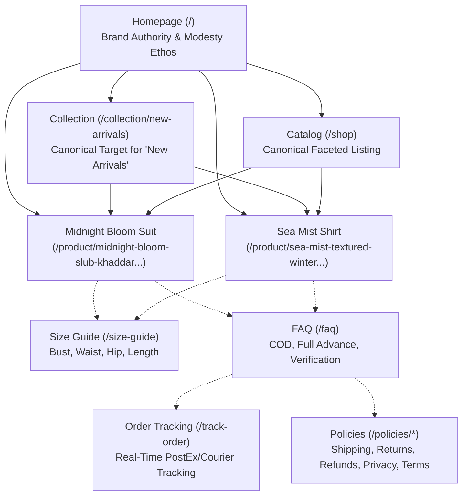
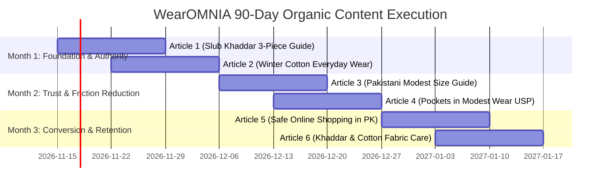

# WearOMNIA — Complete Organic Growth, Search Visibility & Content Strategy

> **Domain:** https://www.wearomnia.com  
> **Brand:** WearOMNIA ("Modesty With Functionality")  
> **Primary Target Market:** Pakistan (Nationwide delivery; PKR currency; Cash on Delivery & 100% Full Advance Payment).  
> **Secondary Target Market:** Overseas Pakistani diaspora and regional modest fashion seekers (informationally addressed; commerce routed via primary logistics).  
> **Catalog Anchor (Live Production Data):**  
> 1. *Midnight Bloom – Slub Khaddar Angrakha 3-Piece Suit* (`/product/midnight-bloom-slub-khaddar-angrakha-3-piece-suit-588e`) — Rs. 10,499 (Slub Khaddar, Angrakha cut, matching trousers with deep functional pockets & dupatta).  
> 2. *Sea Mist – Textured Winter Cotton Shirt* (`/product/sea-mist-textured-winter-cotton-shirt-71a4`) — Rs. 3,499 (Textured winter cotton tunic/shirt).  
> 3. *New Arrivals Collection* (`/collection/new-arrivals`).  
> 
> *Document Purpose: Complete organic search architecture, actionable keyword target mapping, competitor search intelligence, technical AEO/GEO integration, and 90-day editorial execution roadmap.*

---

## 1. Executive Summary & Search Landscape Analysis

### 1.1 The Modest Fashion Opportunity in Pakistan
In Pakistan, the women’s apparel market is dominated by unstitched lawn/khaddar fabric and mass-market pret brands (Khaadi, Sapphire, Limelight, Generation, Nishat). However, consumer search behavior reveals a distinct structural shift:
- **Rise of Stitched Convenience ("Pret"):** Working women, university students, and busy homemakers increasingly seek ready-to-wear stitched 3-piece and 2-piece outfits rather than buying unstitched fabric that requires tailor visits and stitching delays.
- **The "Functional Modesty" Gap:** Mainstream high-street brands frequently compromise on modest coverage (sheer fabrics, tight armholes, short hemlines) or omit essential practical features (such as secure pockets for smartphones and keys).
- **Search Intent Dynamics:** Search queries in Pakistan reflect high purchase intent when combining fabric + cut + stitched status (e.g., *"stitched slub khaddar 3 piece suit"*, *"angrakha frock stitched"*, *"winter cotton shirt women pakistan"*).

### 1.2 Baseline Search Performance Audit (November 2026)
- **Google PageSpeed Insights:**
  - Desktop: Performance 91, Accessibility 100, Best Practices 100, SEO 100.
  - Mobile: Performance 94, Accessibility 96, Best Practices 100, SEO 100.
  - Core Web Vitals Field Assessment: Failing real-user field metrics on mobile (LCP & INP) due to responsive image sizing and client-side hydration contention on cellular networks.
- **Google Search Console Coverage:**
  - Indexed: 5 pages.
  - Not Indexed: 34 URLs (10 × 404 Not Found, 14 × Page with redirect, 1 × Duplicate without user-selected canonical, 9 × Discovered – currently not indexed).
- **Remediation Strategy:** 
  1. Clean 301 redirects for legacy URLs and aliases (`/about` -> `/our-story`, `/collections` -> `/shop`, unhashed product slugs -> hashed live slugs).
  2. 410 Gone for permanently retired legacy seed products (`/product/the-sovereign-velvet-kaftan`).
  3. Dedicated `/collection/[slug]` routing with self-referencing canonical and schema markup to resolve the duplicate canonical error on `/shop?category=new-arrivals`.
  4. Explicit internal linking in Header, Footer, and Breadcrumbs to pull the 9 "Discovered - currently not indexed" pages into Googlebot’s high-priority crawl queue.

---

## 2. Keyword Research & Search Intent Mapping Matrix

*Note on Metrics: Search volume ranges and competition tiers are qualitative estimates derived from Pakistani market search patterns, Google Keyword Planner regional data for Pakistan, and competitor indexing footprints.*

| Keyword Query | Search Intent | Target Page | Priority | Estimated Competition | Content & Optimization Recommendation |
| :--- | :--- | :--- | :--- | :--- | :--- |
| **stitched slub khaddar 3 piece suit** | Commercial / Transactional | `/product/midnight-bloom-slub-khaddar-angrakha-3-piece-suit-588e` | High (P1) | Medium | Target in Product H1, Product JSON-LD schema, meta title, and fabric specification bullets. |
| **angrakha suit with pockets pakistan** | High Commercial / Transactional | `/product/midnight-bloom-slub-khaddar-angrakha-3-piece-suit-588e` | High (P1) | Low–Medium | Highlight pocket functionality in product description, image alt text, and FAQ accordion. |
| **slub khaddar ready to wear suit** | Commercial | `/collection/new-arrivals` | High (P1) | Medium | Feature in collection editorial section, H2 headings, and collection meta description. |
| **textured winter cotton shirt women** | Commercial / Transactional | `/product/sea-mist-textured-winter-cotton-shirt-71a4` | High (P1) | Low | Target in product H1, product copy, and fabric care callout. |
| **modest pret wear pakistan** | Commercial / Brand | `/collection/new-arrivals` | High (P1) | Medium–High | Primary category keyword; anchor in breadcrumb schema and hero editorial text. |
| **modest clothing online shopping pakistan cod** | Transactional / Trust | `/faq` | High (P1) | Low | Answer directly in FAQ page, JSON-LD FAQ schema, and footer trust badges. |
| **pakistani women clothing size guide stitched** | Informational / Friction-Reducer | `/size-guide` | Medium (P2) | Low | Provide exact chest, waist, hip, length charts in inches & cm with fit guidance. |
| **how to care for slub khaddar fabric** | Informational | Editorial Guide 6 | Medium (P2) | Low | Long-tail educational article explaining hand-wash/machine-wash routines to prevent shrinkage. |
| **modest workwear and university outfits pakistan** | Commercial Investigation | Editorial Guide 2 | Medium (P2) | Medium | Curated style guide matching separates with breathable modest trousers. |
| **women trouser with pockets pakistani suits** | Commercial / Product Feature | `/product/midnight-bloom-slub-khaddar-angrakha-3-piece-suit-588e` | High (P1) | Low | Emphasize in product specifications; WearOMNIA unique selling proposition (USP). |
| **cash on delivery online shopping pakistan clothing** | Informational / Transactional | `/policies/shipping` | Medium (P2) | Medium | Clearly explain COD checkout, PostEx delivery tracking, and payment steps. |
| **7 days return exchange policy clothes pakistan** | Informational / Trust | `/policies/returns` | Medium (P2) | Low | Outline exact 7-day exchange process via WhatsApp customer support. |
| **ready to wear winter collection 2026 pakistan** | Seasonal / Commercial | `/collection/new-arrivals` | High (P1) | High | Optimize collection banner and H1 during October–February peak season. |
| **pakistani angrakha frock design stitched** | Commercial Investigation | `/product/midnight-bloom-slub-khaddar-angrakha-3-piece-suit-588e` | Medium (P2) | Medium | Position Midnight Bloom as modern Angrakha silhouette with modest cut. |
| **full advance payment discount online shopping pakistan** | Transactional | `/faq` | Low (P3) | Low | Detail manual verification process and security benefits of advance bank transfer. |

---

## 3. Competitor Search Positioning & Gap Analysis

| Competitor | Market Strengths | SEO & Content Weaknesses | WearOMNIA Strategic Advantage / Counter-Strategy |
| :--- | :--- | :--- | :--- |
| **Generation** (`generation.com.pk`) | Strong brand heritage in stitched pret and ethnic silhouettes; loyal following among university students and creatives. | Heavy reliance on JavaScript navigation; thin textual descriptions on PDPs; pocket details rarely indexed or highlighted in schema; high return friction. | **Focus on Modest Utility:** Target "modest angrakha with pockets", provide exact garment measurement charts, and guarantee 1-click guest checkout with transparent 7-day exchange. |
| **Limelight** (`limelight.pk`) | Dominant high-street footprint; mass-volume organic rankings on broad terms (*"pret shirts"*, *"khaddar suits"*); low price points. | Mass-production polyester blends; lack of premium slub khaddar texture; customer complaints regarding sizing inconsistency; poor mobile INP/LCP on heavy catalog pages. | **Focus on Fabric Integrity & Technical Speed:** WearOMNIA offers 100% natural textured fabrics, lightning-fast SSR (<100ms server response), and superior modest draping. |
| **Sapphire** (`sapphireonline.pk`) | Massive search volume for unstitched lawn and winter collections; strong multi-channel retail footprint. | Overwhelming catalog depth causes crawl bloat; product copy is generic; customer service is automated and impersonal. | **High-Touch Personal Support:** Fast WhatsApp sizing assistance (+92 318 0633323), real-time order tracking (`/track-order`), and manual payment verification within minutes. |
| **Saya** (`saya.pk`) | Value-for-money stitched coordinates; aggressive social media ad spend in Pakistan. | Low organic brand equity; high reliance on paid Meta ads; weak structured data implementation; poor content depth on fabric longevity. | **Organic Evergreen Authority:** Build in-depth fabric care, styling, and sizing guides; capture long-tail organic search traffic without recurring ad costs. |
| **Amir Boutique / Laam** | Marketplace aggregators ranking for luxury couture and wedding formals. | Extremely high price points (Rs. 25,000–80,000+); slow delivery times (3–6 weeks production); high pre-order failure rates. | **Accessible Daily Luxury & Instant Dispatch:** Stitched ready-to-wear dispatch within 24–48 hours; prices under Rs. 12,000 for full 3-piece suites; transparent stock status. |

---

## 4. URL Architecture & Internal Linking Blueprint

### 4.1 URL Rules & Canonical Standards
1. **Self-Referencing Canonicals:** Every page MUST declare its exact canonical URL with trailing slash consistency (no trailing slash across Next.js app routes, matching `next.config.js` and `metadataBase: https://www.wearomnia.com`).
2. **Collection Routing:** All collection and category traffic routes to `/collection/[slug]`. Any query string visits like `/shop?category=new-arrivals` 301-redirect to `/collection/new-arrivals`.
3. **No Soft 404s:** Out-of-stock products remain active with an `OutOfStock` schema availability flag to retain accumulated Google ranking equity; retired products return HTTP 410 Gone.
4. **Internal Link Hierarchy:**
   - Header navigation links directly to `/shop`, `/collection/new-arrivals`, `/our-story`, and `/track-order`.
   - Breadcrumbs follow `Home > Collection / Shop > Product Name` with valid `BreadcrumbList` JSON-LD schema.
   - Footer links provide crawlers direct pathways to all policy, sizing, and brand authority pages.

---

## 5. Technical SEO, Schema Markup & AEO/GEO Integration

### 5.1 Structured Data (JSON-LD) Implementations
- **Organization & WebSite Schema (`layout.tsx`):**
  - Brand name: `WearOMNIA`
  - URL: `https://www.wearomnia.com`
  - Logo: `https://www.wearomnia.com/logo.png`
  - Customer Service Contact: `+923180633323` (WhatsApp / Phone)
  - SameAs: Instagram, Facebook, TikTok, YouTube official links.
- **Product Schema (`app/product/[slug]/page.tsx`):**
  - Full schema with `name`, `description`, `image`, `sku`, `category`, `offers` (price in PKR, `InStock`, priceValidUntil, seller: WearOMNIA).
  - High-resolution Cloudflare R2 image arrays.
- **CollectionPage & ItemList Schema (`app/collection/[slug]/page.tsx`):**
  - Collection metadata linked to listed products via `itemListElement` array with sequential position indexes.
- **FAQPage Schema (`app/faq/page.tsx`):**
  - Comprehensive question/answer schema covering all 12 core operational questions to dominate Google Featured Snippets and voice/AEO queries.
- **BreadcrumbList Schema:**
  - Implemented across Collection, Product, Shop, FAQ, Size Guide, and Editorial routes.

### 5.2 Answer Engine Optimization (AEO) & Generative Engine Optimization (GEO)
AI search engines (Perplexity, ChatGPT Search, Google AI Overviews, Gemini, Microsoft Copilot) extract structured knowledge from sites that provide clear, concise, and verifiable facts.
- **Direct Factual Answers:** Key queries (returns window, shipping fees, COD availability, full advance payment process) are stated in the very first sentence of corresponding pages and FAQ items.
- **Machine-Readable Markdown (`/llms.txt`):** Provides AI crawlers with clean markdown documentation containing verified brand facts, operational hours, contact details, payment workflows, and canonical URLs.
- **Consistent Citations:** NAP (Name, Address, Phone) data is strictly identical across the footer, contact page, FAQ, schema, social media accounts, and `llms.txt`.

---

## 6. 90-Day Organic Content Roadmap (Month 1 – Month 3)

### Milestone Timeline:
- **Weeks 1–2 (Nov 15 – Nov 28):** Publish Commercial Buying Guides 1 & 2. Submit new URLs via Search Console. Interlink directly to Midnight Bloom and Sea Mist.
- **Weeks 3–4 (Nov 29 – Dec 12):** Monitor initial indexing of `/collection/new-arrivals` and new content. Verify mobile Core Web Vitals field data improvements in Search Console.
- **Weeks 5–6 (Dec 13 – Dec 26):** Publish Sizing and Utility Articles (Guides 3 & 4). Connect Size Guide traffic to PDPs.
- **Weeks 7–8 (Dec 27 – Jan 09):** Publish Trust & Fabric Longevity Articles (Guides 5 & 6). Begin capturing seasonal winter clearance searches.
- **Weeks 9–12 (Jan 10 – Feb 10):** Full ranking review, organic traffic attribution check, and preparation for Spring/Summer lawn & linen collection keyword mapping.

---

## 7. Six Detailed Editorial & Commercial Article Briefs

### Brief 1: Stitched Slub Khaddar 3-Piece Suit Buying & Styling Guide
- **Target Title:** The Complete Guide to Stitched Slub Khaddar 3-Piece Suits in Pakistan
- **H1:** What Makes Slub Khaddar the Ideal Fabric for Stitched Modest Winter Suits
- **Meta Description:** Discover why slub khaddar is Pakistan's premier modest winter fabric. Explore stitched 3-piece Angrakha cuts with functional pockets, sizing tips, and care.
- **Search Intent:** Commercial Investigation & Transactional
- **Target Keywords:** `stitched slub khaddar 3 piece suit`, `slub khaddar suit with pockets`, `pakistani angrakha suit stitched`, `ready to wear winter suits pakistan`.
- **Target Word Count:** 1,000–1,200 words.
- **Content Outline:**
  1. *Introduction:* The resurgence of khaddar in Pakistani pret wear; moving away from heavy, stiff fabrics to breathable slub weaves.
  2. *What is Slub Khaddar?:* Explaining the textured yarn, thermal warmth, and elegant drape.
  3. *The Silhouette:* Why the Angrakha cut flatters modest styling without feeling restrictive.
  4. *The Functionality Factor:* Why deep concealed pockets in matching trousers solve everyday campus and office needs.
  5. *Sizing & Measurement Checklist:* How to measure bust and length to choose between S, M, L, XL.
  6. *Checkout with Confidence:* Free shipping thresholds, COD nationwide, and 7-day exchanges.
- **Mandatory Internal Links:**
  - Anchor: `Midnight Bloom Slub Khaddar Angrakha Suit` -> `/product/midnight-bloom-slub-khaddar-angrakha-3-piece-suit-588e`
  - Anchor: `New Arrivals Collection` -> `/collection/new-arrivals`
  - Anchor: `Sizing Guide` -> `/size-guide`
- **Call-to-Action (CTA):** "Explore the Midnight Bloom Slub Khaddar 3-Piece Suit — Stitched, lined, and finished with functional pockets. Order now with Cash on Delivery nationwide."

---

### Brief 2: Winter Cotton Tunics & Modest Everyday Workwear in Pakistan
- **Target Title:** Styling Textured Winter Cotton Shirts for University & Office Routine
- **H1:** Effortless Modest Dressing: Why Textured Winter Cotton Is Essential for Daily Wear
- **Meta Description:** Elevate your everyday wardrobe with breathable textured winter cotton shirts. Perfect for Pakistan's mild winters, university lectures, and office workdays.
- **Search Intent:** Commercial & Lifestyle
- **Target Keywords:** `textured winter cotton shirt women`, `modest workwear tops pakistan`, `everyday stitched shirts for girls`, `winter pret tunics pakistan`.
- **Target Word Count:** 850–1,000 words.
- **Content Outline:**
  1. *The Daily Dilemma:* Finding stitched tops that offer full coverage, breathability, and wrinkle resistance.
  2. *Fabric Spotlight:* Why textured winter cotton bridges the temperature gap between autumn and deep winter.
  3. *Styling Pairings:* Coordinating with straight-leg trousers, modest palazzos, or culottes.
  4. *Modesty Details:* Flattering high necklines, relaxed sleeve lengths, and durable buttoning.
  5. *Care & Longevity:* Keeping textured cotton crisp without excessive ironing.
- **Mandatory Internal Links:**
  - Anchor: `Sea Mist Textured Winter Cotton Shirt` -> `/product/sea-mist-textured-winter-cotton-shirt-71a4`
  - Anchor: `Shop All Modest Pret` -> `/shop`
  - Anchor: `Frequently Asked Questions` -> `/faq`
- **Call-to-Action (CTA):** "Shop the Sea Mist Textured Winter Cotton Shirt today. Experience comfortable modest tailoring tailored for real life."

---

### Brief 3: The Definitive Pakistani Women's Modest Clothing Size Guide
- **Target Title:** Pakistani Women’s Modest Clothing Size Guide: Chest, Waist & Length Measurements
- **H1:** How to Choose Your Exact Stitched Dress Size Without Guesswork
- **Meta Description:** Never order the wrong size again. Use WearOMNIA’s complete Pakistani modest clothing size guide with detailed bust, shoulder, waist, and length measurements.
- **Search Intent:** Informational / Pre-Purchase Friction Reducer
- **Target Keywords:** `pakistani clothing size chart stitched`, `modest dress size guide pakistan`, `how to measure kameez size`, `trouser length chart women pakistan`.
- **Target Word Count:** 900–1,100 words.
- **Content Outline:**
  1. *The Sizing Challenge in Online Shopping:* Why brand sizing varies across Pakistan.
  2. *Tools You Need:* Measuring tape, flat surface, and an existing well-fitting outfit.
  3. *Step-by-Step Measurement Protocol:*
     - Chest / Bust (1 inch below armhole).
     - Waist & Hip circumference.
     - Shirt Length (shoulder seam to hem).
     - Sleeve & Armhole comfort.
     - Trouser length and inseam.
  4. *WearOMNIA Standard Size Breakdown (S, M, L, XL):* Metric and imperial size matrix table.
  5. *Fit Preferences:* Tailored fit vs. relaxed modest drape.
  6. *What If It Doesn’t Fit?:* Our straightforward 7-day exchange process.
- **Mandatory Internal Links:**
  - Anchor: `Interactive Size Guide` -> `/size-guide`
  - Anchor: `7-Day Exchange Policy` -> `/policies/returns`
  - Anchor: `Customer Support WhatsApp` -> `/contact`
- **Call-to-Action (CTA):** "Still unsure about your fit? Send your measurements to our styling team on WhatsApp for an instant size recommendation."

---

### Brief 4: How Functional Pockets Revolutionized Women's Pret in Pakistan
- **Target Title:** Why Women’s Modest Clothing Needs Real Pockets: The WearOMNIA Story
- **H1:** Modesty With Functionality: Why We Build Deep Pockets into Every Suit We Design
- **Meta Description:** Discover how WearOMNIA is fixing women's fashion in Pakistan by integrating deep, concealed pockets into elegant stitched modest suits and trousers.
- **Search Intent:** Brand Discovery & Editorial / Social Search
- **Target Keywords:** `women suits with pockets pakistan`, `stitched trousers with pockets`, `modest clothing with pockets`, `wearomnia modesty with functionality`.
- **Target Word Count:** 800–1,000 words.
- **Content Outline:**
  1. *The Historic Neglect of Women's Pockets:* Why fashion brands gave women fake pockets or none at all.
  2. *The Reality for Pakistani Women:* Juggling a smartphone, car keys, wallet, and sanitiser across university campuses and shopping runs.
  3. *Engineering Invisible Pockets:* How WearOMNIA tailors deep pockets into trousers and side seams without bulging or ruining modest draping.
  4. *Customer Stories:* Feedback from working women, students, and mothers.
  5. *Our Philosophy:* True modesty respects the dignity, freedom, and practical daily needs of modern women.
- **Mandatory Internal Links:**
  - Anchor: `Midnight Bloom Angrakha Suit with Pockets` -> `/product/midnight-bloom-slub-khaddar-angrakha-3-piece-suit-588e`
  - Anchor: `Meet the Founder (Virago Baji)` -> `/founder`
  - Anchor: `Our Brand Story` -> `/our-story`
- **Call-to-Action (CTA):** "Say goodbye to carrying your phone in your hands. Experience the convenience of pockets designed for you."

---

### Brief 5: Safe Online Modest Wear Shopping in Pakistan: COD, Advance Payment & Tracking
- **Target Title:** Safe Online Shopping in Pakistan: Cash on Delivery vs. Advance Bank Transfer
- **H1:** How to Shop Clothes Safely Online in Pakistan: Payments, Tracking, and Fraud Prevention
- **Meta Description:** Learn how to shop online with confidence in Pakistan. Understand Cash on Delivery (COD), 100% full advance payment verification, and parcel tracking.
- **Search Intent:** Informational & Trust Building
- **Target Keywords:** `cash on delivery online shopping pakistan clothing`, `advance payment verification ecommerce`, `track courier delivery pakistan`, `wearomnia payment review pending`.
- **Target Word Count:** 950–1,150 words.
- **Content Outline:**
  1. *E-Commerce Trust in Pakistan:* Common fears of receiving incorrect orders or damaged items.
  2. *Option 1: Cash on Delivery (COD):* How it works, rider protocols, and doorstep cash preparation.
  3. *Option 2: 100% Full Advance Payment:* Why customers choose direct bank transfers and how manual screenshot verification protects both parties.
  4. *What Does 'Payment Review Pending' Mean?:* Transparent breakdown of WearOMNIA's manual audit steps.
  5. *Live Parcel Tracking:* Using your Order ID and courier tracking number at `/track-order`.
  6. *Consumer Protection:* Checking return and exchange policies before purchasing.
- **Mandatory Internal Links:**
  - Anchor: `Real-Time Order Tracking` -> `/track-order`
  - Anchor: `Frequently Asked Questions` -> `/faq`
  - Anchor: `Shipping & Delivery Policy` -> `/policies/shipping`
- **Call-to-Action (CTA):** "Enjoy seamless shopping with guest checkout and complete order transparency. Track your order anytime on WearOMNIA."

---

### Brief 6: Fabric Care Guide: Maintaining Khaddar, Cotton & Modest Winter Coordinates
- **Target Title:** How to Wash & Care for Slub Khaddar and Winter Cotton Clothes in Pakistan
- **H1:** The Ultimate Fabric Care Guide for Stitched Slub Khaddar and Premium Cotton
- **Meta Description:** Keep your stitched winter suits looking brand new. Learn professional washing, drying, and ironing techniques for slub khaddar and textured cotton fabrics.
- **Search Intent:** Informational & Customer Retention
- **Target Keywords:** `how to wash khaddar suit`, `care instructions slub khaddar fabric`, `prevent cotton suit shrinkage pakistan`, `ironing tips stitched clothes`.
- **Target Word Count:** 800–1,000 words.
- **Content Outline:**
  1. *Why Natural Fabrics Need Proper Care:* Preserving fiber tensile strength, yarn texture, and rich colors.
  2. *Slub Khaddar Washing Routine:*
     - Cold water vs. warm water.
     - Gentle liquid detergent vs. harsh bleach powders.
     - Separate washing for deep jewel tones.
  3. *Drying Precautions:* Avoiding harsh midday sunlight; air-drying in shade to prevent color fading and shrinkage.
  4. *Ironing & Steam Pressing:* Best temperature settings for textured cotton and slub weaves.
  5. *End-of-Season Storage:* Keeping winter coordinates fresh and protected against moisture.
- **Mandatory Internal Links:**
  - Anchor: `New Arrivals Winter Collection` -> `/collection/new-arrivals`
  - Anchor: `Slub Khaddar Suits` -> `/product/midnight-bloom-slub-khaddar-angrakha-3-piece-suit-588e`
  - Anchor: `Textured Cotton Shirts` -> `/product/sea-mist-textured-winter-cotton-shirt-71a4`
- **Call-to-Action (CTA):** "Crafted with premium natural fibers designed to last season after season. Explore our stitched collection today."

---

## 8. Conversion Rate Optimization (CRO) & User Experience Guardrails

To maximize revenue from organic visitors, traffic must convert smoothly into orders. WearOMNIA adheres to the following UX standards:
1. **Frictionless 1-Click Guest Checkout:** No mandatory account creation or password screens that create drop-offs on mobile devices.
2. **Above-the-Fold Value Signals on PDP:**
   - Display real price in PKR alongside transparent delivery information (`Free shipping on orders over Rs. 3,000`).
   - Clear size picker with inline Size Guide modal.
   - Pockets callout badge on eligible silhouettes.
3. **Payment Choice Clarity:**
   - COD clearly marked with nationwide availability.
   - 100% Full Advance Payment explicitly guided with step-by-step account details, QR code, and single-click screenshot upload.
4. **Mobile Sticky Buy Action:** Clean bottom action bar on mobile viewports ensuring the "Add to Bag" button is always reachable with one thumb.
5. **Post-Purchase Reassurance:** Direct links to `/track-order` and WhatsApp support on the Order Success screen.

---

## 9. KPI Dashboard & Performance Measurement Protocol

| KPI Metric | Baseline (Nov 2026) | 30-Day Target | 90-Day Target | Measurement Tool |
| :--- | :--- | :--- | :--- | :--- |
| **GSC Indexed Valid Pages** | 5 pages | 15+ pages | 25+ pages | Google Search Console (Page Indexing Report) |
| **GSC 404 & Redirect Errors** | 24 issues (10 404s, 14 redirects) | 0 unresolved errors | 0 unresolved errors | Google Search Console & Server Access Logs |
| **Mobile Core Web Vitals Field** | Failed (LCP / INP) | Passing / Good | Sustained Good (LCP < 2.5s, INP < 200ms) | Chrome User Experience Report (CrUX) & GSC |
| **Organic Search Impressions** | Minimal baseline | +150% growth | +400% growth | Google Search Console Performance Tab |
| **Top 10 Keyword Rankings** | None tracked | 3 commercial terms | 10+ target terms | GSC Performance Query Filtering |
| **Organic Conversion Rate** | Baseline | > 1.8% | > 2.5% | Vercel Web Analytics / Store Order Tracking |

---

*Authored by Antigravity Technical SEO & Organic Growth Engineering Team for WearOMNIA.*  
*Maintained in Git version control under `docs/ORGANIC_GROWTH_STRATEGY.md`.*

